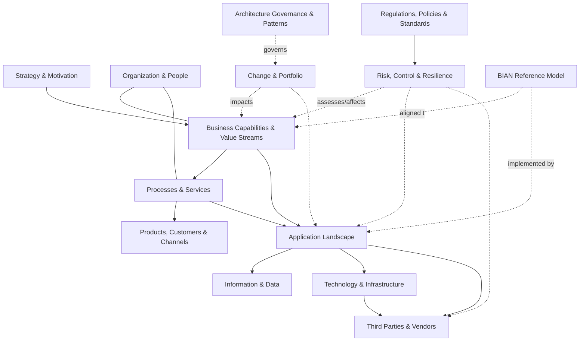

# Ardoq Banking Enterprise Architecture Metamodel — Starter Schema

Companion guide to `ardoq_banking_ea_metamodel_starter.csv`. It explains the schema structure, every architecture domain (business, people, applications, data, technology, risk, third party, change), how the domains connect, and what to watch for when loading it into Ardoq.

## 1. What this is

A starter metamodel for a retail / universal bank, expressed as a flat CSV that describes **workspaces, component types, reference types and fields** in Ardoq's vocabulary. It is a *design artefact*: use it to create the metamodel in Ardoq (UI, Excel importer for the data, or the API), then load real data.

| Element | Count |
|---|---|
| Workspaces | 14 |
| Component types | 69 (49 Core, 20 Extended) |
| Reference types (names) | 85 |
| Reference rows (source → target pairs) | 328 |
| Component fields | 356 |
| Common fields (all types) | 5 |
| Reference fields | 32 |

## 2. Research basis

The schema follows how Ardoq structures its own metamodels, plus banking and regulatory frameworks:

- **Ardoq structure:** *workspaces* contain *components* (typed) and *references* (typed, directional); custom *fields* sit on components or references. Component types can be nested to form hierarchies inside a workspace; references can cross workspaces.
- **Ardoq solution metamodels reused:** Foundation (Organization, Application, Person), Business Capability Modeling & Realization (*Is Realized By*), Strategy to Execution (Objective, Key Result, Initiative, Capability Delta, *Assigned To*, *Is Dependency For*), Organizational Modeling (Organization, Organizational Unit, Person, *Belongs To*), Application & Technology Portfolio (Application, Application Module, Interface, Technology Service, Server, Data Store, Technology Product), Future States (*Impacts*, *Has Subject*), Reference Architecture Patterns (weakly-typed Design Object + *References*), DORA solution (Requirement, Assessment).
- **Frameworks:** BIAN (Business Area → Business Domain → Service Domain), TOGAF content metamodel and TRM, Business Architecture Guild (capabilities, value streams, information concepts), ArchiMate layers, DORA / UK operational resilience, BCBS 239, SR 11-7, EU AI Act.
- **Ardoq's seven metamodelling principles:** keep the number of types controlled, avoid over-specialising. That is why the schema uses *one* Business Capability type with a Level field, *one* Business Process type with a Level field, and *one* Risk type with a Level field instead of separate types per level. Ardoq also advises against the retired *Application Group* type, so it is not included.

## 3. CSV structure

One row per schema element. Columns:

| Column | Meaning |
|---|---|
| Schema ID | Stable ID: `WS-`, `CT-`, `RT-`, `FD-` |
| Element Kind | Workspace · Component Type · Reference Type · Field (Common) · Field (Component) · Field (Reference) |
| Domain | Architecture layer (Business, Data, Application, Technology, Governance, Risk, Third Party, Change, Reference) |
| Workspace | Ardoq workspace that holds the element |
| Element Name | Component type, reference type or field name |
| Parent Type / Source Type / Owning Element | Component types: allowed parent type (hierarchy). Reference types: source component type. Fields: owning component or reference type |
| Target Component Type | Reference types only. `(Any Component Type)` = weakly typed |
| Field Data Type | Text, Text Area, Number, Number (Calculated), Date, Checkbox, List, Multi-select List, URL, Email |
| Allowed Values / Notes | List options separated by `;`, or guidance |
| Required | Y = recommended mandatory, N = optional |
| Tier | Core = load first; Extended = add as the practice matures |
| Description | What the element means |
| Banking Context / Example | Banking-specific example |
| Framework Alignment | Source pattern (Ardoq, BIAN, TOGAF, DORA, etc.) |

Reference types with several sources or targets are **expanded to one row per source→target pair**, so the CSV can drive scripts directly.

## 4. Architecture at a glance

## 5. Workspaces and component types

### 5.1 Strategy & Motivation

*Domain: Business. Strategy, objectives, key results and drivers (Ardoq Strategy to Execution pattern).*

| Component type | Parent (hierarchy) | Tier | Meaning | Banking example | Key fields |
|---|---|---|---|---|---|
| **Strategy** | — | Core | Enterprise or business-line strategy | Digital-First Retail Bank 2030 | Strategy Horizon, Plan Start Date, Plan End Date |
| **Driver** | — | Extended | Internal or external force motivating change | PSD3 open finance; fintech competition; rate cycle | Driver Category |
| **Objective** | Objective | Core | Strategic objective (can be nested) | Reduce cost-to-income ratio below 50% | Objective Type, Priority, Objective Status |
| **Key Result** | Objective | Core | Measurable result for an objective | Digital sales share 70% by FY27 | Metric Unit, Baseline Value, Current Value |

### 5.2 Business Capabilities & Value Streams

*Domain: Business. Capability map and value streams (BIAN / BA Guild aligned).*

| Component type | Parent (hierarchy) | Tier | Meaning | Banking example | Key fields |
|---|---|---|---|---|---|
| **Business Capability** | Business Capability | Core | What the bank can do; L1-L4 hierarchy via parent | Payments > Instant Payments > Payment Fraud Screening | Capability Level |
| **Value Stream** | — | Core | End-to-end value delivery to a stakeholder | Open a Current Account; Originate a Mortgage | Value Stream Type, Value Outcome, Target Cycle Time |
| **Value Stream Stage** | Value Stream | Core | Stage of a value stream | Verify Identity (KYC); Underwrite; Disburse | Stage Sequence |

### 5.3 Business Processes & Services

*Domain: Business. Processes, business services and business events.*

| Component type | Parent (hierarchy) | Tier | Meaning | Banking example | Key fields |
|---|---|---|---|---|---|
| **Business Process** | Business Process | Core | Process L1-L4 hierarchy via parent | Customer Due Diligence; Trade Settlement; Loan Collections | Process Level |
| **Business Service** | — | Core | Service offered to customers or internal consumers | Domestic Payment Service; FX Dealing Service | Service Type, Service Tier, Is Important Business Service |
| **Business Event** | — | Extended | Trigger of a process or value stream | Account opening request; Payment return; Margin call | Event Type |

### 5.4 Products, Customers & Channels

*Domain: Business. Banking products, customer segments, channels, journeys and payment/market infrastructure.*

| Component type | Parent (hierarchy) | Tier | Meaning | Banking example | Key fields |
|---|---|---|---|---|---|
| **Product Category** | Product Category | Core | Product taxonomy node | Deposits; Lending; Cards; Treasury | Product Family |
| **Product** | Product Category | Core | Banking product or service offered | Fixed-Rate Mortgage; Business Current Account | Product Code, Product Family, Product Status |
| **Customer Segment** | Customer Segment | Core | Customer or stakeholder group | Mass Affluent; SME; Financial Institutions | Segment Type, Regulatory Classification, Customer Count |
| **Channel** | — | Core | Customer or partner interaction channel | Mobile App; Branch; Open Banking API | Channel Type |
| **Customer Journey** | — | Extended | End-to-end customer experience | Onboarding; Dispute resolution | Journey Type, Customer Satisfaction Score |
| **Journey Stage** | Customer Journey | Extended | Step in a customer journey | Document upload; Approval notification | Stage Sequence |
| **Payment & Market Infrastructure** | — | Core | External scheme, FMI or network the bank connects to | SWIFT; SEPA Instant; Fedwire; CHAPS; Visa; CLS; LCH | Infrastructure Type |

### 5.5 Organization & People

*Domain: Business. Legal entities, business lines, org units, people, roles, locations, jurisdictions.*

| Component type | Parent (hierarchy) | Tier | Meaning | Banking example | Key fields |
|---|---|---|---|---|---|
| **Organization** | — | Core | Root group organization | Global Banking Group plc | Group LEI, Registered Name |
| **Legal Entity** | Organization | Core | Licensed or registered legal entity | UK Retail Bank Ltd; EU Broker-Dealer SA | Entity Type |
| **Business Line** | Business Line | Core | Cross-entity line of business (Basel business lines) | Retail Banking; Commercial Banking; Markets | Business Line Type, Is Core Business Line |
| **Organizational Unit** | Organizational Unit | Core | Division, department, branch or group | Group Operations; Credit Risk Department | Unit Type, Cost Centre Code, Headcount |
| **Team** | Team | Extended | Delivery, support or product team | Payments Platform Team | Team Type, Headcount |
| **Person** | — | Core | Individual (keep PII minimal) | Enterprise Architect; Application Owner | Job Title, Email Address, Employment Type |
| **Role** | — | Core | Role or accountability function | Application Owner; Data Steward; SMF24 Chief Operations | Role Category, Regulatory Function Code, Is Regulated Role |
| **Governance Body** | — | Extended | Committee or board | Architecture Review Board; Model Risk Committee | Body Type, Meeting Frequency |
| **Location** | Location | Core | Physical or cloud location | London HQ; Frankfurt DC; Azure West Europe | Location Type |
| **Jurisdiction** | — | Core | Country or regulatory region | United Kingdom; European Union; Singapore | Jurisdiction Type, ISO Country Code, Data Residency Restriction |

### 5.6 Information & Data

*Domain: Data. Data domains, entities, critical data elements and data products.*

| Component type | Parent (hierarchy) | Tier | Meaning | Banking example | Key fields |
|---|---|---|---|---|---|
| **Data Domain** | Data Domain | Core | Subject area grouping of data | Party; Account; Transaction; Collateral; Ledger | Data Subject Area |
| **Data Entity** | Data Domain | Core | Logical business data concept | Customer; Loan Agreement; Payment Instruction; Exposure | Data Classification |
| **Data Element** | Data Entity | Extended | Attribute / critical data element | Counterparty LEI; Probability of Default | Data Type, Business Definition, Is Critical Data Element |
| **Data Product** | — | Extended | Curated data asset for consumption | Customer 360 view; Daily Liquidity Positions | Data Product Status, Refresh Frequency, Access Policy |

### 5.7 Application Landscape

*Domain: Application. Applications, modules, services and interfaces.*

| Component type | Parent (hierarchy) | Tier | Meaning | Banking example | Key fields |
|---|---|---|---|---|---|
| **Application** | Application | Core | Business-recognised software system | Core Banking; Payments Hub; Loan Origination; AML Monitoring | Application Type, Deployment Model, Business Criticality |
| **Application Module** | Application | Core | Functional component of an application | Deposits module; Card Authorisation module | Module Type, Version, Release Cadence |
| **Application Service** | — | Extended | Logical service exposed by an application | Account Balance Service; Sanctions Screening Service | Service Type, Exposure |
| **Interface** | — | Core | Integration point (API, file, message, event) | Payments ISO 20022 gateway; Open Banking AIS API | Interface Type |

### 5.8 Technology & Infrastructure

*Domain: Technology. Technology products, services, servers, data stores, cloud accounts, network zones.*

| Component type | Parent (hierarchy) | Tier | Meaning | Banking example | Key fields |
|---|---|---|---|---|---|
| **Technology Product** | — | Core | Vendor product / version in the technology catalogue | Oracle 19c; Red Hat OpenShift; Temenos Transact | Product Category, Standard Status |
| **Technology Service** | Technology Service | Core | Platform or infrastructure service | Kafka Platform; Azure Kubernetes Service; HSM Service | Service Category |
| **Technical Capability** | Technical Capability | Extended | Technical capability from TRM | API Management; Identity & Access; Observability | Capability Category, Strategic Importance |
| **Server** | — | Core | Compute node, VM, cluster or LPAR | PRD-DB-014; Mainframe LPAR PROD1 | Server Type, Environment |
| **Data Store** | — | Core | Database, warehouse, lake or file store | Customer Master DB; Risk Data Lake | Data Store Type |
| **Cloud Account** | — | Core | Cloud subscription, account or project | AWS payments-prod; Azure risk-analytics | Cloud Provider |
| **Network Zone** | — | Extended | Network segment or security zone | PCI Zone; DMZ; Partner Extranet | Zone Type |

### 5.9 Regulations, Policies & Standards

*Domain: Governance. Regulations, requirements, policies, standards, principles, regulatory reports.*

| Component type | Parent (hierarchy) | Tier | Meaning | Banking example | Key fields |
|---|---|---|---|---|---|
| **Regulatory Authority** | — | Core | Regulator, central bank or standard setter | PRA; FCA; ECB; Fed; OCC; MAS; BCBS | Authority Type |
| **Regulation** | — | Core | Law, regulation, directive or guidance | DORA; BCBS 239; PSD2; GDPR; SR 11-7 | Regulation Type |
| **Requirement** | Regulation | Core | Specific article or obligation | DORA Art. 28 Register of Information | Requirement ID |
| **Policy** | — | Core | Internal policy | Third-Party Risk Management Policy | Policy Type, Policy Version, Approval Date |
| **Standard** | — | Core | Internal, industry or regulatory standard | Cloud Security Standard; ISO 20022; ISO 27001 | Standard Type, Standard Version, Next Review Date |
| **Principle** | — | Extended | Architecture or business principle | API-first; Data is an asset | Rationale, Implications |
| **Regulatory Report** | — | Core | Report submitted to a regulator | COREP; FINREP; FR Y-9C; LCR/NSFR; AnaCredit | Report Code, Report Category, Reporting Frequency |

### 5.10 Risk, Control & Resilience

*Domain: Risk. Risks, controls, assessments, issues, incidents, critical functions, models.*

| Component type | Parent (hierarchy) | Tier | Meaning | Banking example | Key fields |
|---|---|---|---|---|---|
| **Risk** | Risk | Core | Risk taxonomy node (L1-L3 via parent) | Operational Risk > Business Disruption | Risk Level, Risk Category |
| **Control** | — | Core | Preventive, detective or corrective control | Four-eyes payment release; Quarterly access recertification | Control Type |
| **Assessment** | — | Core | Assessment, test or review record | Business Impact Analysis; DPIA; Vendor due diligence | Assessment Type |
| **Issue** | — | Core | Finding, audit issue or risk acceptance | Internal Audit finding on access controls | Severity, Issue Status |
| **Incident** | — | Core | Operational or ICT incident | Payments outage; Ransomware event | Incident Severity |
| **Critical or Important Function** | — | Core | Function whose disruption threatens viability or stability | Payments Execution; Deposit-taking; Liquidity Management | Designation Framework |
| **Model** | — | Extended | Quantitative, AI or ML model | IFRS 9 ECL model; Fraud ML model; PD scorecard | Model Type |

### 5.11 Third Parties & Vendors

*Domain: Third Party. Vendors and third-party / ICT arrangements (DORA Register of Information ready).*

| Component type | Parent (hierarchy) | Tier | Meaning | Banking example | Key fields |
|---|---|---|---|---|---|
| **Vendor** | Vendor | Core | Supplier or service provider | Cloud provider; Core banking vendor; Payment processor | Vendor Type |
| **Third-Party Arrangement** | — | Core | Contract or outsourcing arrangement | Master Services Agreement with Cloud Provider | Contract ID, Arrangement Type |

### 5.12 Change & Portfolio

*Domain: Change. Initiatives, capability deltas, future states, technical debt.*

| Component type | Parent (hierarchy) | Tier | Meaning | Banking example | Key fields |
|---|---|---|---|---|---|
| **Initiative** | Initiative | Core | Programme, project or epic | Core Banking Modernisation; DORA Compliance Programme | Initiative Type, Initiative Status |
| **Capability Delta** | — | Extended | Capability gap to be closed | Real-time fraud scoring capability | Delta Type, Current Maturity, Target Maturity |
| **Future State** | — | Extended | Target or transition architecture | Target State 2028; Transition Q4 2026 | State Type |
| **Technical Debt** | — | Extended | Known architectural debt item | Unsupported mainframe batch scheduler | Debt Type, Estimated Remediation Cost, Risk Impact |

### 5.13 Architecture Governance & Patterns

*Domain: Governance. Decision records, patterns and design objects.*

| Component type | Parent (hierarchy) | Tier | Meaning | Banking example | Key fields |
|---|---|---|---|---|---|
| **Architecture Decision Record** | — | Extended | Recorded architecture decision | ADR-042 Adopt event streaming for payments | Decision Status |
| **Architecture Pattern** | — | Extended | Reusable reference architecture | Instant Payments Reference Architecture | Pattern Type, Pattern Status, Pattern Version |
| **Design Object** | Architecture Pattern|Design Object | Extended | Weakly-typed building block inside a pattern | Gateway; Queue; Fraud Check box | Design Object Type |

### 5.14 BIAN Reference Model

*Domain: Reference. BIAN business areas, domains, service domains and service operations.*

| Component type | Parent (hierarchy) | Tier | Meaning | Banking example | Key fields |
|---|---|---|---|---|---|
| **BIAN Business Area** | — | Core | Top BIAN level | Sales & Service; Risk & Compliance | BIAN ID, BIAN Version |
| **BIAN Business Domain** | BIAN Business Area | Core | Mid-level BIAN grouping | Loans & Deposits; Payments | BIAN ID, BIAN Version |
| **BIAN Service Domain** | BIAN Business Domain | Core | Atomic BIAN functional building block | Current Account; Payment Execution; Credit Risk Assessment | BIAN ID, BIAN Version, Asset Type |
| **BIAN Service Operation** | BIAN Service Domain | Extended | Service operation of a service domain | Initiate; Retrieve; Execute | Action Term, Service Group |

## 6. Domain deep dives

### 6.1 Business architecture
- **Capabilities** are the stable backbone: one `Business Capability` type, L1–L4 via parent nesting plus a `Capability Level` field. `Capability Domain` offers a banking L1 taxonomy (Customer Management, Lending & Credit, Deposits & Accounts, Payments & Transaction Services, Cards, Treasury & Markets, Trade Finance, Wealth, Finance, Risk Management, Compliance & Financial Crime, Operations, Data, Technology, and enabling functions).
- Strategic evaluation fields (`Strategic Importance`, `Maturity Level`, `Performance Rating`, `Investment Posture`, `Regulatory Critical`) support heat maps; `Supporting Application Count` is a calculated field counting *Is Realized By* references.
- **Value streams** (e.g. Open a Current Account, Originate a Mortgage) decompose into stages; each stage *Is Enabled By* capabilities and is *Realized By* processes.
- **Processes** nest L1–L4; they are *Supported By* applications, *Performed By* org units / roles / outsourced arrangements, and *Use* data entities with CRUD detail.
- **Products, segments, channels** capture what the bank sells, to whom, and how. Products nest under categories (Deposits, Lending, Cards…) and link to channels, segments, business lines, jurisdictions and the application that processes them.
- **Payment & Market Infrastructure** (SWIFT, SEPA Instant, Fedwire, card networks, CCPs) is a first-class type because connectivity and participation drive resilience and regulatory scope.

### 6.2 People and organization
- Hierarchy: `Organization` → `Legal Entity` → `Organizational Unit` (self-nesting) → `Team`. `Business Line` is deliberately **separate and cross-cutting**, as banks run business lines across several legal entities; org units link via *Belongs To*, legal entities via *Is Conducted By*.
- `Person` and `Role` are separate: accountability is modelled with references (*Is Owned By*, *Is Stewarded By*, *Is Accountable For*, *Is Subject Matter Expert For*, *Is Member Of*), **not text fields**, so ownership stays queryable and survives staff changes.
- `Role` supports regulatory accountability (e.g. SM&CR function codes via `Regulatory Function Code`).
- `Line of Defence` on org units supports three-lines risk governance. `Location` and `Jurisdiction` support data residency and sovereignty analysis.
- Keep Person data minimal (job title, work email, directory ID); avoid sensitive personal attributes.

### 6.3 Data
- `Data Domain` → `Data Entity` → `Data Element` hierarchy; `Data Subject Area` values follow banking subject areas (Party, Account & Agreement, Product, Transaction, Collateral, Instrument & Market Data, Position & Exposure, Ledger & Finance, Risk & Capital, Reference Data).
- Classification and privacy flags (`Data Classification`, `Contains PII`, `Contains Payment Card Data`, `Contains Special Category Data`, `Is Critical Data Element`, `In Scope for BCBS 239`, `Regulatory Scope`) enable privacy, PCI and risk-data-aggregation views.
- **Lineage:** `Data Element` / `Data Entity` *Feeds* `Regulatory Report`; applications *Access* entities (CRUD); *Is Mastered By* records the golden source; *Sends Data To* shows flows between applications and data stores.
- `Data Product` supports data-mesh style publishing.

### 6.4 Applications
- `Application` is the business-recognised system (Core Banking, Payments Hub, Loan Origination, AML Monitoring…). `Application Module` nests beneath it for functional or microservice detail. `Application Service` is optional.
- `Interface` covers APIs, files, messages, events, ETL; fields capture protocol, format (ISO 20022, SWIFT MT, ISO 8583, FIX), exposure and the Open Banking / PSD2 flag.
- Portfolio fields: `Application Type`, `Deployment Model`, `Business Criticality` (Tier 0–4), `TIME Disposition`, `Go-Live Date`, `End of Support Date`, `Recovery Time/Point Objective`, `Annual Run Cost`, fit scores, `Supports Critical or Important Function`, `Is Material Outsourcing`.
- Lifecycle: *Has Successor* (with planned cutover date) models replacement.
- Banking tie-ins: applications *Connect To* payment infrastructure and *Implement* BIAN service domains.

### 6.5 Technology
- `Technology Product` (catalogue entry with `Standard Status`: Strategic / Tolerated / Contained / Retire / Prohibited, support end dates, licence model) is separated from its **operational instances** (`Technology Service`, `Server`, `Data Store`, `Application`) via *Is Instance Of*. This follows Ardoq's Technology Portfolio pattern.
- `Is Hosted On` connects applications and data stores to servers, cloud accounts or platform services, with an environment (Production / DR / UAT…) and a primary / secondary role.
- `Cloud Account` (AWS / Azure / GCP subscriptions) and `Location` (data centres, cloud regions) support concentration-risk and data residency analysis. `Network Zone` supports security segmentation (PCI zone, DMZ).
- `Technical Capability` maps to the TOGAF Technical Reference Model.

### 6.6 Regulation, risk, control and resilience
- `Regulation` → `Requirement` hierarchy (DORA, BCBS 239, PSD2, GDPR, SR 11-7…). Requirements are *Satisfied By* controls, policies, processes or applications with a coverage level and evidence link.
- `Risk` (L1–L3) uses a bank taxonomy (credit, market, liquidity, operational, compliance, conduct, financial crime, cyber, technology, third-party, model, strategic, reputational, climate, legal) plus Basel operational-risk event types. *Control* *Mitigates* risk; risks *Affect* capabilities, processes, applications, products and third parties.
- `Assessment`, `Issue` and `Incident` give an audit trail: assessments *Raise* issues, issues are *Remediated By* initiatives, incidents *Impact* applications and critical functions.
- `Critical or Important Function` is the resilience anchor (DORA CIF, UK Important Business Service, US/BCBS critical operations) with impact-tolerance, scenario-test fields and a *Depends On* chain into processes, applications, technology, third parties and locations.
- `Model` supports model risk (tiering, validation status, EU AI Act risk class).

### 6.7 Third parties
- `Vendor` and `Third-Party Arrangement` are split so one vendor can have many contracts. Arrangement fields align with a DORA Register of Information style record: materiality, substitutability, exit plan, subcontracting, data location, audit rights.
- *Covers* links an arrangement to the applications, services, cloud accounts and processes it supports; *Supports* links it to critical functions; *Subcontracts To* models fourth-party chains.

### 6.8 Change, portfolio and governance
- `Initiative` (programme → project) *Impacts* any layer, *Addresses* requirements, issues, risks or technical debt, and is staffed through *Assigned To* (with `Time Allocated (%)`).
- `Future State`, `Capability Delta`, `Technical Debt` support transition planning.
- `Architecture Decision Record`, `Architecture Pattern` and `Design Object` capture decisions and reusable patterns. `Design Object` and the generic *References* type are deliberately weakly typed, as in Ardoq's reference-architecture approach.
- `Governance Body` *Approves* ADRs, policies, standards, initiatives and patterns.

### 6.9 BIAN reference model
- Four nested types: Business Area → Business Domain → Service Domain → Service Operation. Business capabilities are *Aligned To* BIAN domains; applications *Implement* service domains; interfaces *Implement* service operations.
- `Coverage Status` on Service Domain (Not / Partially / Fully Covered) is intended to be calculated from *Implements* references to reveal functional gaps and overlaps.
- Ardoq offers a prebuilt BIAN import (Business Capabilities and Business Domains workspaces). It is gated behind an Ardoq contact and BIAN knowledge confirmation, so you may load BIAN content via that route or directly from the BIAN site.

## 7. Reference catalogue

Grouped by reference name. `→` lists allowed targets for each source. `Core` = load first.

| Reference | Source → Target(s) | Tier |
|---|---|---|
| **Has Objective** | Strategy → Objective | Core |
| **Is Driven By** | Strategy, Objective → Driver | Extended |
| **Supports** | Initiative, Business Capability, Objective → Objective | Core |
| **Supports** | Model → Business Process | Extended |
| **Supports** | Third-Party Arrangement → Critical or Important Function | Core |
| **Is Governed By** | Application, Technology Service, Business Process, Data Store, Interface, Initiative → Policy, Standard, Principle | Core |
| **Impacts** | Initiative → Business Capability, Business Process, Business Service, Product, Application, Application Module, Interface, Technol… | Core |
| **Addresses** | Initiative → Requirement, Issue, Technical Debt, Risk | Core |
| **Delivers** | Initiative → Capability Delta, Future State | Extended |
| **Is Dependency For** | Initiative → Initiative | Core |
| **Assigned To** | Person, Team, Organizational Unit → Initiative | Core |
| **Is Sponsored By** | Initiative → Person, Business Line | Extended |
| **Targets** | Capability Delta → Business Capability | Extended |
| **Has Subject** | Future State → Business Capability, Business Process, Application, Technology Service, Organizational Unit, Product, Data Entity | Extended |
| **Precedes** | Future State → Future State | Extended |
| **Is Realized By** | Business Capability → Application, Application Module, Business Process, Organizational Unit | Core |
| **Is Realized By** | Technical Capability → Technology Product, Technology Service | Extended |
| **Is Realized By** | Channel → Application, Technology Service | Core |
| **Is Realized By** | Business Service → Business Process, Application Service | Core |
| **Depends On** | Business Capability → Business Capability | Extended |
| **Depends On** | Application → Application | Core |
| **Depends On** | Technology Service → Technology Service | Core |
| **Depends On** | Critical or Important Function → Business Process, Application, Technology Service, Third-Party Arrangement, Location | Core |
| **Is Enabled By** | Value Stream Stage → Business Capability | Core |
| **Serves** | Value Stream, Product, Customer Journey, Business Service → Customer Segment | Core |
| **Is Triggered By** | Value Stream, Business Process → Business Event | Extended |
| **Realizes** | Business Process → Value Stream Stage, Business Service | Core |
| **Triggers** | Business Process → Business Process | Extended |
| **Is Supported By** | Business Process → Application, Application Module, Application Service | Core |
| **Is Supported By** | Application, Application Module → Technology Service, Data Store | Core |
| **Is Supported By** | Product → Application, Business Capability | Core |
| **Is Supported By** | Journey Stage → Business Process | Extended |
| **Is Supported By** | Business Service → Application Service | Extended |
| **Is Performed By** | Business Process → Organizational Unit, Role, Third-Party Arrangement | Core |
| **Is Performed By** | Critical or Important Function → Legal Entity, Organizational Unit | Core |
| **Uses** | Business Process, Model → Data Entity | Core |
| **Is Offered Through** | Product, Business Service → Channel | Core |
| **Is Delivered By** | Product → Business Service | Extended |
| **Is Offered By** | Product → Business Line, Legal Entity | Core |
| **Touches** | Journey Stage → Channel | Extended |
| **Belongs To** | Person → Organizational Unit, Team | Core |
| **Belongs To** | Team → Organizational Unit | Core |
| **Belongs To** | Organizational Unit → Business Line | Core |
| **Is Conducted By** | Business Line → Legal Entity | Core |
| **Performs** | Person → Role | Core |
| **Is Located At** | Organizational Unit, Server, Legal Entity → Location | Core |
| **Operates In** | Legal Entity, Business Line → Jurisdiction | Core |
| **Is Available In** | Product → Jurisdiction | Extended |
| **Is Located In** | Location → Jurisdiction | Core |
| **Applies In** | Regulation → Jurisdiction | Core |
| **Is Owned By** | Business Capability, Business Process, Business Service, Product, Application, Application Module, Data Entity, Data Domain, Technology Service, Interface, Risk, Control, Policy, Standard, Initiative, Model, Critical or Important Function, Third-Party Arrangement, Vendor, Regulatory Report → Person | Core |
| **Is Owned By** | Business Capability, Business Process, Product, Application, Technology Service, Data Domain, Risk, Control, Policy → Organizational Unit | Core |
| **Is Managed By** | Application, Technology Service, Server, Data Store, Interface → Team, Organizational Unit | Core |
| **Is Stewarded By** | Data Entity, Data Domain, Data Element → Person | Core |
| **Is Subject Matter Expert For** | Person → Business Capability, Business Process, Application, Technology Service, Data Domain | Extended |
| **Is Accountable For** | Role → Business Capability, Business Process, Critical or Important Function, Risk, Product | Extended |
| **Is Member Of** | Person → Governance Body | Extended |
| **Approves** | Governance Body → Architecture Decision Record, Policy, Standard, Initiative, Architecture Pattern | Extended |
| **Accesses** | Application, Application Module → Data Entity | Core |
| **Is Stored In** | Data Entity, Data Element → Data Store | Core |
| **Is Mastered By** | Data Entity, Data Domain → Application | Core |
| **Carries** | Interface → Data Entity | Core |
| **Feeds** | Data Element, Data Entity → Regulatory Report | Core |
| **Is Derived From** | Data Element → Data Element | Extended |
| **Is Derived From** | Data Product → Data Entity, Data Store | Extended |
| **Sends Data To** | Application → Application, Data Store | Core |
| **Sends Data To** | Data Store → Application, Data Store | Core |
| **Exposes** | Application, Application Module → Interface | Core |
| **Consumes** | Application, Application Module → Interface | Core |
| **Is Provided By** | Application Service → Application, Application Module | Extended |
| **Implements** | Application, Application Module → BIAN Service Domain | Core |
| **Implements** | Interface, Application Service → BIAN Service Operation | Extended |
| **Implements** | Policy → Requirement, Regulation | Core |
| **Implements** | Standard → Policy | Extended |
| **Is Aligned To** | Business Capability → BIAN Service Domain, BIAN Business Domain | Core |
| **Has Successor** | Application → Application | Core |
| **Has Successor** | Technology Product → Technology Product | Extended |
| **Has Successor** | Technology Service → Technology Service | Extended |
| **Is Hosted On** | Application, Application Module → Server, Cloud Account, Technology Service | Core |
| **Is Hosted On** | Data Store, Technology Service → Server, Cloud Account | Core |
| **Is Instance Of** | Application, Technology Service, Server, Data Store → Technology Product | Core |
| **Is Supplied By** | Application, Technology Product, Technology Service, Cloud Account → Vendor | Core |
| **Resides In** | Server, Data Store → Network Zone | Extended |
| **Connects To** | Network Zone → Network Zone | Extended |
| **Connects To** | Application, Application Module → Payment & Market Infrastructure | Core |
| **Is Participant In** | Legal Entity → Payment & Market Infrastructure | Core |
| **Is Issued By** | Regulation → Regulatory Authority | Core |
| **Is Regulated By** | Legal Entity → Regulatory Authority | Core |
| **Is Submitted To** | Regulatory Report → Regulatory Authority | Core |
| **Applies To** | Regulation → Legal Entity, Business Line, Product, Business Process, Application, Data Entity | Core |
| **Applies To** | Requirement → Business Capability, Business Process, Application, Data Entity, Third-Party Arrangement | Core |
| **Applies To** | Policy → Business Line, Business Process, Application | Extended |
| **Is Satisfied By** | Requirement → Control, Policy, Business Process, Application | Core |
| **Mitigates** | Control → Risk | Core |
| **Is Implemented By** | Control → Business Process, Application, Technology Service, Organizational Unit | Core |
| **Affects** | Risk → Business Capability, Business Process, Application, Product, Critical or Important Function, Third-Party Arrangement,… | Core |
| **Assesses** | Assessment → Application, Business Process, Business Capability, Vendor, Third-Party Arrangement, Initiative, Critical or Importan… | Core |
| **Raises** | Assessment → Issue | Core |
| **Is Raised Against** | Issue → Application, Business Process, Control, Third-Party Arrangement, Requirement, Model, Technology Service | Core |
| **Is Remediated By** | Issue → Initiative | Core |
| **Impacted** | Incident → Application, Technology Service, Critical or Important Function, Business Service, Third-Party Arrangement, Product | Core |
| **Has Root Cause In** | Incident → Application, Technology Service, Vendor, Third-Party Arrangement | Extended |
| **Gave Rise To** | Incident → Issue | Extended |
| **Is Deployed In** | Model → Application | Extended |
| **Is Recorded Against** | Technical Debt → Application, Technology Service, Interface, Server, Data Store | Extended |
| **Maps To** | Critical or Important Function → Business Capability, Business Service | Core |
| **Is With** | Third-Party Arrangement → Vendor | Core |
| **Covers** | Third-Party Arrangement → Application, Technology Service, Cloud Account, Business Process, Business Service, Technology Product | Core |
| **Subcontracts To** | Vendor, Third-Party Arrangement → Vendor | Core |
| **Supersedes** | Architecture Decision Record → Architecture Decision Record | Extended |
| **References** | Design Object, Architecture Decision Record → (Any Component Type) | Extended |
| **Is Applied In** | Architecture Pattern → Application, Initiative, Technology Service | Extended |

### Reference fields

| Reference | Field | Type | Values / notes |
|---|---|---|---|
| Assigned To | Time Allocated (%) | Number | 0-100 |
| Assigned To | Role on Initiative | List | Sponsor;Lead;Architect;Delivery;SME |
| Impacts | Impact Type | List | Introduce;Change;Replace;Retire;Migrate |
| Impacts | Impact Level | List | Low;Medium;High |
| Is Realized By | Support Level | List | Full;Partial;Planned |
| Depends On | Dependency Type | List | Runtime;Data;Hosting;Operational;Contractual |
| Depends On | Dependency Criticality | List | Low;Medium;High;Critical |
| Accesses | CRUD Operations | Multi-select List | Create;Read;Update;Delete |
| Accesses | Access Method | List | API;Direct DB;File;Message |
| Uses | CRUD Operations | Multi-select List | Create;Read;Update;Delete |
| Sends Data To | Data Classification | List | Public;Internal;Confidential;Restricted |
| Sends Data To | Frequency | List | Real-Time;Near Real-Time;Intraday;Daily;Weekly;Monthly;Quarterly;Annually;On Demand |
| Sends Data To | Protocol | Text | e.g. REST; SFTP; Kafka; MQ |
| Sends Data To | Message Standard | List | ISO 20022;SWIFT MT;ISO 8583;FIX;JSON;XML;Flat File |
| Sends Data To | Avg Daily Volume | Number | records or messages |
| Sends Data To | Is Real-Time | Checkbox |  |
| Is Hosted On | Environment | List | Production;DR;UAT;SIT;Development;Test |
| Is Hosted On | Hosting Role | List | Primary;Secondary;DR |
| Is Instance Of | Version in Use | Text |  |
| Has Successor | Planned Cutover Date | Date |  |
| Is Mastered By | Mastery Type | List | System of Record;System of Reference;System of Entry |
| Feeds | Report Cell or Field Reference | Text | e.g. COREP template cell |
| Mitigates | Mitigation Effectiveness | List | Full;Partial;Minimal |
| Is Satisfied By | Coverage Level | List | Full;Partial;Gap |
| Is Satisfied By | Evidence Link | URL |  |
| Applies To | Applicability Rationale | Text |  |
| Connects To | Connection Type | List | Direct;Via Service Bureau;Via Correspondent |
| Connects To | Message Standard | List | ISO 20022;SWIFT MT;ISO 8583;FIX;Proprietary |
| Is Participant In | Participation Type | List | Direct;Indirect;Sponsored |
| Is Participant In | Participant ID (e.g. BIC) | Text |  |
| References | Reference Type | Text | Free-text specialisation of the generic reference |
| Covers | Coverage Scope | Text |  |

## 8. Common fields (every component type)

| Field | Type | Values / notes | Required |
|---|---|---|---|
| Lifecycle Status | List | Proposed;Planned;Active;Phasing Out;Retired | Y |
| External ID | Text | ID in source system, CMDB, GRC or BIAN | N |
| Source of Record | Text | System the data was imported from | N |
| Last Reviewed Date | Date | — | N |
| Data Quality Rating | List | High;Medium;Low | N |

Field names avoid Ardoq's reserved names (e.g. `name`, `description`, `type`, `parent`, `source`, `order`, `color`, `created`, `id`). That is why the schema uses names such as `Stage Sequence` and `Source of Record`.

## 9. Key traversal paths (what you can answer)

| Question | Path |
|---|---|
| Which applications support a critical function, and where are they hosted? | Critical or Important Function → *Depends On* → Application → *Is Hosted On* → Server / Cloud Account → *Is Located At* → Location → *Is Located In* → Jurisdiction |
| Which third parties does a critical function depend on? | Critical or Important Function ← *Supports* ← Third-Party Arrangement → *Is With* → Vendor → *Subcontracts To* → Vendor |
| What is impacted if an application fails? | Application ← *Is Supported By* ← Business Process → *Realizes* → Business Service / Value Stream Stage; Application ← *Is Realized By* ← Business Capability |
| Where does regulatory report data come from? | Regulatory Report ← *Feeds* ← Data Element / Data Entity → *Is Mastered By* → Application → *Sends Data To* → … |
| Which regulations apply to which systems, and are we covered? | Regulation → Requirement → *Applies To* → Application; Requirement → *Is Satisfied By* → Control (coverage level) |
| Which BIAN service domains lack application coverage? | BIAN Service Domain ← *Implements* ← Application (none = gap) |
| What will an initiative change? | Initiative → *Impacts* → capabilities, processes, applications, technology, data, vendors |
| Who owns, stewards or supports something? | Component → *Is Owned By* / *Is Managed By* / *Is Stewarded By* → Person / Team / Org Unit |
| Which end-of-life technology risks which services? | Technology Product (`End of Extended Support`, `Standard Status`) ← *Is Instance Of* ← Technology Service / Server / Application |

## 10. Banking-specific highlights

- **Operational resilience first:** a dedicated `Critical or Important Function` type with dependency mapping to processes, applications, technology, third parties and locations.
- **DORA-ready third-party model:** vendor and contract split, materiality, substitutability, exit plans, subcontracting chains, CTPP flag, Register of Information flag.
- **BCBS 239 lineage:** Critical Data Elements, golden-source mastery and lineage to regulatory reports.
- **Cross-cutting business lines:** Basel-style business lines separate from legal entities, supporting resolution planning (`Is Material Legal Entity`, `Is Core Business Line`).
- **Payments and market infrastructure** as explicit types with message standards (ISO 20022, SWIFT MT, ISO 8583, FIX).
- **Model risk and AI:** SR 11-7 style tiering and validation; EU AI Act risk class.
- **Regulatory accountability:** roles tied to SM&CR-style function codes and *Is Accountable For* references.
- **Data residency and sovereignty:** Location and Jurisdiction with residency restrictions.

## 11. Implementation guidance

1. **Phase 1 (Core):** load Core component types and Core references first (capabilities, processes, products, org, applications, interfaces, data entities, technology, vendors, critical functions, regulations/requirements).
2. **Phase 2:** add Extended types (journeys, data elements, models, patterns, future states, network zones) as the practice matures.
3. **Create in Ardoq:** workspaces → component types (set the parent type for each hierarchy) → fields → reference types. Reference types can be created on first import in the Excel importer; the workspace context API (`/api/v2/workspaces/{id}/context`) lets you verify types, hierarchy and fields afterwards.
4. **Load data:** the Excel importer maps columns to component names, types, fields, tags or references. Use `::` fully qualified paths to indicate hierarchy, and import components before references.
5. **Governance:** assign owners through references, agree naming and level conventions, and review the metamodel regularly against Ardoq's principle of keeping type counts small.
6. **Reports and dashboards:** the calculated fields (`Supporting Application Count`, `Progress (%)`, BIAN `Coverage Status`) need Ardoq calculated-field / scripting setup.

## 12. Caveats and assumptions

- This is a **starter**, not a complete enterprise model. Trim or extend it to your bank's scale, regions and regulatory perimeter.
- **Field data type names** (Text, List, Multi-select List, etc.) are mapped to the closest Ardoq field types; confirm exact type names and any multi-select behaviour in your tenant.
- Reference type names are consistent with Ardoq's naming style. A reference name reused across different source types (e.g. *Is Realized By*) is one reference type with several allowed source/target pairs in the CSV; configure allowed pairs in Ardoq per workspace as required.
- Allowed values are **suggested defaults** (regulatory lists, taxonomies, thresholds); align them with your internal policies and the current text of each regulation or framework. BIAN field values are simplified; confirm against the BIAN release you adopt.
- Currency fields are stored as Numbers with the reporting currency noted. Where multi-currency matters, add a currency field.
- Avoid loading sensitive personal data into `Person`; keep it to organizational attributes.
